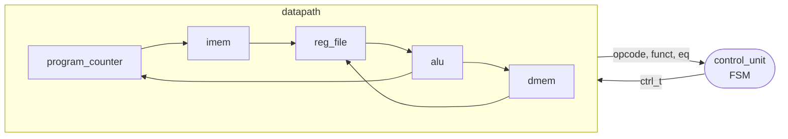

# 8-bit MIPS-style CPU in VHDL

[](https://github.com/jpmlima/FPGA-Single-Cycle-Datapath-and-Control/actions/workflows/sim.yml)

A small processor with a MIPS-inspired instruction set, written in synthesizable
VHDL and targeting an Intel Cyclone IV E (Terasic DE2-115). A Harvard datapath
is driven by a finite-state control unit, and every instruction takes 3–4 cycles.

- 16-bit instructions, 8-bit data, 8 general-purpose registers (`r0` hardwired to zero)
- 16 ALU operations: arithmetic, logic, shifts, signed/unsigned compare, multiply
- `lw`, `sw`, `addi`, `beq` and register-register ALU instructions
- Self-checking GHDL testbenches, run in CI on every push

## Architecture



The control unit steps through `FETCH → DECODE → EXECUTE → WRITEBACK | MEM_WRITE | BRANCH`.
All control lines travel in one `ctrl_t` record, so adding a signal is a change
in one package instead of four port lists.

Full datapath, FSM and control-signal tables: [docs/architecture.md](docs/architecture.md).

## Instruction set

| Opcode | Instruction        | Operation                       |
|--------|--------------------|---------------------------------|
| `000`  | `nop`              |                                 |
| `001`  | `<op> rd, rs, rt`  | `rd <- rs <op> rt` (16 ALU ops) |
| `010`  | `beq rs, rt, imm`  | branch if `rs == rt`            |
| `100`  | `addi rt, rs, imm` | `rt <- rs + imm`                |
| `110`  | `sw rt, imm(rs)`   | `mem[rs + imm] <- rt`           |
| `111`  | `lw rt, imm(rs)`   | `rt <- mem[rs + imm]`           |

Encoding, ALU function codes and cycle counts: [docs/isa.md](docs/isa.md).

## Repository layout

```
rtl/
  cpu_pkg.vhd          types, ISA constants, ctrl_t record
  program_pkg.vhd      default program and data memory contents
  cpu.vhd              top level: control_unit + datapath
  control_unit.vhd     instruction sequencing FSM
  datapath.vhd         wires the blocks below together
  program_counter.vhd  alu.vhd  reg_file.vhd  imem.vhd  dmem.vhd
  sign_extend.vhd      mux2.vhd
tb/
  tb_alu.vhd           every ALU operation plus overflow and sign edge cases
  tb_cpu.vhd           runs the default program end to end
quartus/               Quartus Prime project (Cyclone IV E, EP4CE115F29C7)
docs/                  architecture and ISA reference
```

## Simulation

Requires [GHDL](https://github.com/ghdl/ghdl) (CI uses 6.0).

```sh
make test   # analyze, elaborate and run all testbenches
make wave   # write build/tb_cpu.ghw for GTKWave or Surfer
```

`tb_cpu` runs the program in `rtl/program_pkg.vhd`. It checks that the
taken branch skips address 3 and the not-taken branch falls through, then checks
the final register and memory contents:

```
tb/tb_alu.vhd:84:5:@18ns:(report note): tb_alu: all 18 vectors passed
tb/tb_cpu.vhd:89:5:@630ns:(report note): tb_cpu: program ran as expected
```

## Synthesis

Open `quartus/cpu.qpf` in Quartus Prime Lite (19.1 or newer) and compile.
The top level `cpu` exposes `pc` and `instr` so the design can be observed on
LEDs or with SignalTap. Pin assignments still need to be added for the target board.

## Running your own program

Edit `PROGRAM` and `DATA_INIT` in `rtl/program_pkg.vhd`, or pass them as
generics to `cpu`. The instruction ROM holds `2**IMEM_ADDR_BITS` words (8 by
default); unused words are `nop` and the PC wraps around.

## History

The original Quartus projects from 2020 are kept at the
[`coursework-2020`](https://github.com/jpmlima/FPGA-Single-Cycle-Datapath-and-Control/tree/coursework-2020)
tag. Changes since then:

- **Restructure:** split into packages, generic modules and a single `ctrl_t` control bundle.
- **Decoder fix:** opcodes `011` and `101` used to decode as `lw` because of a `<=` comparison; they now execute as `nop`.
- **NOP fix:** `nop` no longer writes to the register file.
- **Portable libraries:** replaced non-standard `std_logic_arith`/`std_logic_signed` with `numeric_std`.
- **Tests:** added self-checking testbenches and CI.
