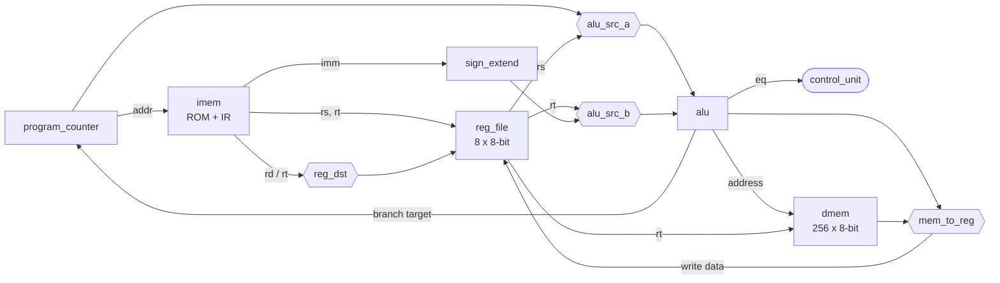
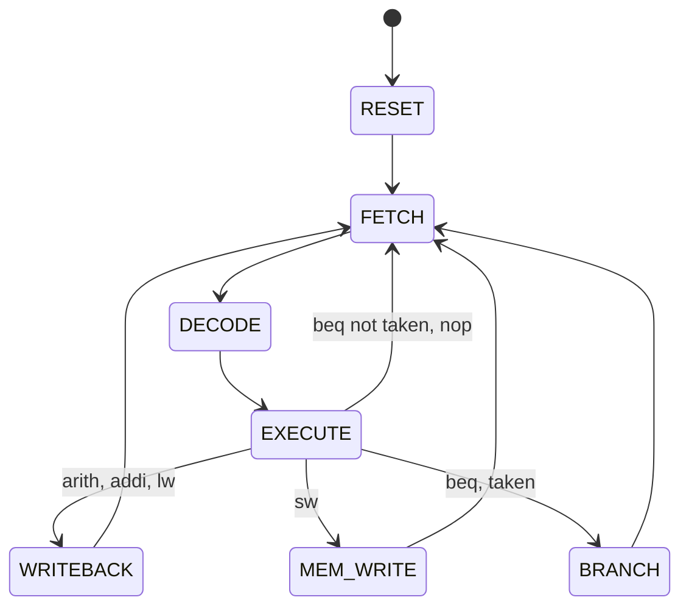

# Architecture

The CPU has two parts:

- **`datapath`**: PC, instruction ROM, register file, ALU and data RAM, with separate instruction and data memories (Harvard).
- **`control_unit`**: an FSM that drives the datapath through a `ctrl_t` record (`rtl/cpu_pkg.vhd`).

Each instruction takes 3 or 4 clock cycles. The ALU is shared: it computes
addresses for `lw`/`sw`, results for arithmetic, the comparison for `beq` and
the branch target.

## Datapath

| Block            | File                      | Notes                                              |
|------------------|---------------------------|----------------------------------------------------|
| Program counter  | `rtl/program_counter.vhd` | Async reset; increment has priority over load      |
| Instruction ROM  | `rtl/imem.vhd`            | Registered output, so it doubles as the instruction register |
| Register file    | `rtl/reg_file.vhd`        | 2 async read ports, 1 sync write port, `r0 = 0`    |
| Sign extender    | `rtl/sign_extend.vhd`     | 7 → 8 bits                                         |
| ALU              | `rtl/alu.vhd`             | 16 operations, `eq` flag for `beq`                 |
| Data RAM         | `rtl/dmem.vhd`            | Async read, sync write                             |
| Mux              | `rtl/mux2.vhd`            | Generic width, used four times                     |

## Control FSM

| State       | What happens                                                         |
|-------------|----------------------------------------------------------------------|
| `FETCH`     | `IR <- IMEM[PC]`, `PC <- PC + 1`                                     |
| `DECODE`    | Opcode is classified and registered                                  |
| `EXECUTE`   | ALU computes the result or address; `beq` compares `rs` and `rt`     |
| `WRITEBACK` | Result (ALU or memory) written to `rd` (R-type) or `rt` (I-type)     |
| `MEM_WRITE` | `mem[rs + imm] <- rt`                                                |
| `BRANCH`    | `PC <- PC + imm` (PC already holds the branch address + 1)           |

## Control signals

| Signal       | 0                 | 1                         |
|--------------|-------------------|---------------------------|
| `pc_inc`     | hold              | `PC <- PC + 1`            |
| `pc_load`    | hold              | `PC <- ALU result`        |
| `ir_load`    | hold IR           | `IR <- IMEM[PC]`          |
| `reg_write`  | –                 | write register file       |
| `reg_dst`    | write to `rd`     | write to `rt`             |
| `alu_src_a`  | `PC`              | `rs`                      |
| `alu_src_b`  | `rt`              | sign-extended `imm`       |
| `mem_write`  | –                 | write data memory         |
| `mem_to_reg` | ALU result        | memory read data          |
